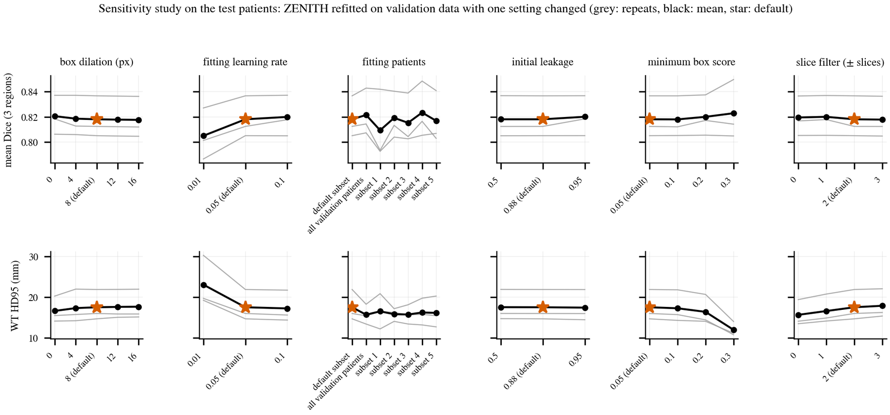
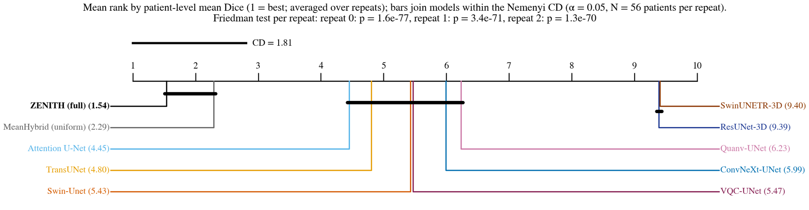

<div align="center">

# ZENITH

**Detection-gated hybrid fusion of CNN, transformer and quantum-hybrid networks for brain tumor segmentation on MRI**

[](https://www.python.org/)
[](https://pytorch.org/)
[](https://monai.io/)
[](https://www.kaggle.com/)
[](https://www.med.upenn.edu/cbica/brats2020/)
[](LICENSE)

[Overview](#overview) •
[Results](#results) •
[Method](#method) •
[Quick start](#quick-start) •
[Data mapping](#hdf5-to-nifti-mapping) •
[Outputs](#outputs) •
[Reproducibility](#reproducibility)

<br>


</div>

<br>

> [!NOTE]
> This repository contains the code behind the paper **"ZENITH: Detection-Gated Opinion Pooling of CNN, Transformer and Quantum-Hybrid Segmenters for Brain Tumor MRI"**. All numbers below come from one complete run of `zenith.ipynb` (three repeats, every network trained from scratch).

## Overview

On MRI, a glioma is outlined as three nested regions: the whole tumor (WT), the tumor core (TC) inside it, and the enhancing tumor (ET) inside the core. A single network usually finds the bulk of the lesion but leaves small false islands far away from it, and those islands are what push boundary metrics such as HD95 up.

ZENITH works on this from two sides. It combines eight segmentation networks of very different design through a small fusion head that learns how much to trust each network and how strongly to discount voxels where a network is unsure. It also asks three box detectors where the tumor is and keeps the fused probability only inside those zones. A fitted temperature then calibrates the result. The fusion head has **33 parameters** and sits on top of trained networks that hold 194.5 M parameters in total, 83.2 M of them in the detectors.

For every case, ZENITH returns a mask per region and two voxel-wise uncertainty maps: the entropy of the fused prediction and the part of it caused by disagreement between members.

**Highlights**

- **One notebook, end to end.** Data checks, thirteen models, fusion, baselines, a sensitivity study, statistics, seventeen figures and the result tables all come from a single run of `zenith.ipynb`.
- **Mixed members.** 2D and 3D CNNs, 2D and 3D transformers, and two U-Nets with exactly simulated, noiseless quantum circuits of 4 and 8 qubits.
- **Detection as a spatial prior.** Faster R-CNN, RetinaNet and FCOS boxes are painted into soft 3D zones, merged with a noisy-OR and used to gate the fused map.
- **Fair baselines.** Learned stackers, a stacker that also sees the gate and a hard detector mask are fitted on the same voxels as ZENITH.
- **Explicit behavior of the gate.** A voxel can only become tumor where the gate support passes a threshold that follows from the fitted parameters, and the same threshold caps recall.
- **A fair quantum test.** Each quantum model is paired with a classical twin that has exactly the same number of parameters.
- **Careful statistics.** Patient-level repeated splits, tests computed inside each repeat, corrected t-tests, Wilcoxon and Friedman tests, and a sensitivity study of every fixed setting.
- **Built for Kaggle.** Every finished model is saved at once, so an interrupted session continues where it stopped.

## Results

Three repeats of Monte Carlo cross-validation over patients (MCCV) on the 369 BraTS 2020 training patients, with 56 test patients per repeat. Because each repeat draws its own split, the three test sets overlap and hold 146 distinct patients. Values are means over the repeats; HD95 is in millimeters and lower is better.

| Model | Type | ET Dice | ET HD95 | TC Dice | TC HD95 | WT Dice | WT HD95 |
|:--|:--:|:--:|:--:|:--:|:--:|:--:|:--:|
| Attention U-Net | 2D CNN | 0.672 | 66.6 | 0.780 | 45.1 | 0.850 | 48.1 |
| TransUNet | 2D transformer | 0.669 | 65.5 | 0.773 | 46.5 | 0.853 | 47.6 |
| Swin-Unet | 2D transformer | 0.675 | 44.0 | 0.755 | 21.7 | 0.843 | 32.8 |
| VQC-UNet | 2D quantum-hybrid | 0.666 | 67.4 | 0.758 | 48.3 | 0.852 | 47.4 |
| MeanHybrid (uniform average) | 2D + 3D hybrid | 0.702 | 51.7 | 0.803 | 26.4 | 0.870 | 38.4 |
| **ZENITH** | **2D + 3D hybrid** | **0.744** | **28.4** | **0.814** | **8.3** | **0.896** | **17.5** |

<details>
<summary><b>All models with standard deviations, size, rank and runtime</b></summary>
<br>

| Model | ET Dice | ET HD95 | TC Dice | TC HD95 | WT Dice | WT HD95 | Rank | Params (M) | Time (s) |
|:--|:--:|:--:|:--:|:--:|:--:|:--:|:--:|:--:|:--:|
| ConvNeXt-UNet | 0.671 ± 0.037 | 66.6 ± 6.2 | 0.745 ± 0.020 | 52.3 ± 9.2 | 0.834 ± 0.011 | 54.9 ± 3.5 | 5.99 | 9.4 | 0.91 |
| Attention U-Net | 0.672 ± 0.028 | 66.6 ± 11.6 | 0.780 ± 0.012 | 45.1 ± 12.2 | 0.850 ± 0.008 | 48.1 ± 7.1 | 4.45 | 7.9 | 0.59 |
| ResUNet-3D | 0.536 ± 0.039 | 87.7 ± 5.6 | 0.492 ± 0.058 | 66.3 ± 9.4 | 0.576 ± 0.064 | 67.0 ± 1.2 | 9.39 | 16.8 | 0.72 |
| TransUNet | 0.669 ± 0.049 | 65.5 ± 6.9 | 0.773 ± 0.029 | 46.5 ± 8.0 | 0.853 ± 0.016 | 47.6 ± 4.6 | 4.80 | 18.7 | 0.60 |
| Swin-Unet | 0.675 ± 0.048 | 44.0 ± 15.8 | 0.755 ± 0.024 | 21.7 ± 3.7 | 0.843 ± 0.011 | 32.8 ± 4.6 | 5.43 | 27.2 | 0.57 |
| SwinUNETR-3D | 0.514 ± 0.090 | 90.2 ± 10.2 | 0.511 ± 0.058 | 71.0 ± 10.9 | 0.600 ± 0.096 | 69.1 ± 1.9 | 9.40 | 15.7 | 1.48 |
| Quanv-UNet | 0.650 ± 0.037 | 76.9 ± 10.3 | 0.752 ± 0.033 | 54.4 ± 8.5 | 0.833 ± 0.008 | 54.2 ± 2.1 | 6.23 | 7.8 | 0.57 |
| Quanv-UNet (classical twin) | 0.666 ± 0.042 | 67.4 ± 5.7 | 0.781 ± 0.030 | 45.1 ± 10.4 | 0.853 ± 0.003 | 51.0 ± 0.9 | n/a | 7.8 | 0.53 |
| VQC-UNet | 0.666 ± 0.042 | 67.4 ± 9.9 | 0.758 ± 0.006 | 48.3 ± 9.0 | 0.852 ± 0.008 | 47.4 ± 6.1 | 5.47 | 7.8 | 0.53 |
| VQC-UNet (classical twin) | 0.666 ± 0.046 | 62.6 ± 9.1 | 0.763 ± 0.009 | 42.4 ± 6.3 | 0.858 ± 0.006 | 44.4 ± 6.1 | n/a | 7.8 | 0.53 |
| MeanHybrid | 0.702 ± 0.040 | 51.7 ± 10.1 | 0.803 ± 0.034 | 26.4 ± 2.1 | 0.870 ± 0.004 | 38.4 ± 7.0 | 2.29 | 111.2 | 6.43 |
| **ZENITH** | **0.744 ± 0.025** | **28.4 ± 9.7** | **0.814 ± 0.025** | **8.3 ± 1.7** | **0.896 ± 0.002** | **17.5 ± 3.8** | **1.54** | 194.5 | 9.49 |

Values are the mean ± SD of the three repeat means. Rank is the mean Friedman rank of patient-level Dice; the two classical twins are controls and are not ranked. ZENITH's parameter count includes the three detectors. Time is the median number of seconds per volume on a Tesla T4.

</details>

<details>
<summary><b>Each repeat on its own</b></summary>
<br>

No patient is pooled across repeats. Every test below is computed inside one repeat, on its 56 distinct test patients.

| | Repeat 1 | Repeat 2 | Repeat 3 |
|:--|:--:|:--:|:--:|
| ZENITH, Dice ET / TC / WT | 0.739 / 0.804 / 0.894 | 0.772 / 0.841 / 0.897 | 0.722 / 0.795 / 0.898 |
| MeanHybrid, Dice ET / TC / WT | 0.685 / 0.795 / 0.869 | 0.747 / 0.841 / 0.868 | 0.673 / 0.774 / 0.874 |
| WT HD95, ZENITH / MeanHybrid (mm) | 21.9 / 41.2 | 14.7 / 43.6 | 16.0 / 30.4 |
| Friedman p (k = 10, N = 56) | 1.6e-77 | 3.4e-71 | 1.3e-70 |
| Mean rank, ZENITH / MeanHybrid / best single | 1.43 / 2.36 / 3.98 | 1.66 / 2.12 / 4.45 | 1.52 / 2.39 / 4.09 |
| Patients where ZENITH beats MeanHybrid in mean Dice | 87.5% | 71.4% | 76.8% |
| Patients where the gate raises WT Dice | 92.9% | 94.6% | 94.6% |

</details>

### What the experiments show

- Compared with the best single network for each region (classical twins included), ZENITH adds 0.069 (ET), 0.033 (TC) and 0.038 (WT) Dice and lowers the best single WT HD95 from 32.8 mm to 17.5 mm.
- Against plain averaging of the same eight members, the gain comes mainly from precision (0.833 against 0.778, averaged over regions), while sensitivity stays close (0.849 against 0.867).
- The detection prior carries most of the gain. Learned stackers without detector input stay close to uniform averaging, a hard detector mask comes within 0.002 of ZENITH's ET and TC Dice, and a stacker that sees the gate reaches its WT Dice. Without the gate, ZENITH loses 0.042 ET Dice and its WT HD95 climbs back to 34.5 mm.
- Fitting the member weights on their own makes them collapse onto Swin-Unet, leaving an effective 1.41 of 8 members. Fitted jointly with the gate and the temperature, 4.57 effective members remain.
- The fitted gate admits tumor only where the detector support reaches 0.473 to 0.492. The share of tumor voxels above that threshold (0.987 for ET, 0.995 for TC and WT) is the most ZENITH can recover; its sensitivity (0.825, 0.828, 0.893) stays well below this ceiling.
- No gate or optimizer setting moves the test mean Dice by more than 0.005, except a learning rate of 0.01, with which the 300 fitting steps do not converge (0.013 lower). Five other random sets of 12 fitting patients give a mean Dice of 0.809 to 0.823.
- In noiseless simulation with 4 and 8 qubits, both quantum-hybrid U-Nets fall short of their parameter-matched classical twins in every region, and leaving them out of the fusion moves Dice by 0.005 at most.
- If a reader corrects the 1% of brain voxels where ZENITH is least sure, mean Dice goes from 0.818 to 0.933.
- ZENITH ranks first in every repeat. The cost is runtime: 9.49 s per volume on a T4 against 6.43 s for MeanHybrid, and the three detectors explain the gap.

<details>
<summary><b>Fusion ablation and baselines</b></summary>
<br>

All variants and baselines are fitted on the same validation voxels with the same loss and optimizer.

| Variant | Fitted params | ET Dice | TC Dice | WT Dice | ET HD95 | TC HD95 | WT HD95 | N<sub>eff</sub> |
|:--|:--:|:--:|:--:|:--:|:--:|:--:|:--:|:--:|
| MeanHybrid (uniform) | 0 | 0.702 | 0.803 | 0.870 | 51.7 | 26.4 | 38.4 | 8.00 |
| +W | 24 | 0.675 | 0.765 | 0.852 | 44.0 | 22.5 | 34.8 | 1.41 |
| +W+C | 27 | 0.681 | 0.778 | 0.868 | 42.0 | 18.7 | 32.4 | 1.58 |
| +W+C+G | 30 | 0.730 | 0.800 | 0.889 | 29.1 | 9.5 | 20.6 | 2.35 |
| **ZENITH (+W+C+G+T)** | 33 | **0.744** | **0.814** | **0.896** | 28.4 | **8.3** | 17.5 | 4.57 |
| without CNN members (5) | 24 | 0.740 | 0.806 | 0.894 | 28.2 | 9.1 | 17.8 | 3.54 |
| without transformer members (5) | 24 | 0.746 | 0.817 | 0.892 | 28.9 | 9.4 | 20.4 | 3.18 |
| without quantum-hybrid members (6) | 27 | 0.749 | 0.812 | 0.896 | 26.2 | 8.2 | 17.3 | 3.70 |
| without detection gate | 30 | 0.702 | 0.796 | 0.875 | 46.3 | 19.6 | 34.5 | 3.98 |
| 2D members only (6) | 27 | 0.740 | 0.808 | 0.891 | 28.4 | 9.2 | 19.8 | 3.27 |
| 3D members only (2) | 15 | 0.690 | 0.664 | 0.832 | 30.1 | 15.5 | 26.7 | 1.72 |
| Logistic stacker on member logits | 27 | 0.704 | 0.799 | 0.876 | 45.3 | 16.2 | 33.4 | n/a |
| 1×1 MLP stacker | 899 | 0.695 | 0.767 | 0.879 | 46.7 | 19.5 | 29.6 | n/a |
| 1×1 MLP stacker with gate input | 995 | 0.732 | 0.778 | 0.896 | 32.3 | 13.2 | 16.9 | n/a |
| MeanHybrid × detector mask [G ≥ 1/2] | 0 | 0.742 | 0.813 | 0.884 | 29.4 | 11.5 | 28.1 | n/a |

W: learned reliability weights, C: confidence modulation, G: detection gate, T: temperature. N<sub>eff</sub> = 1 / Σ<sub>m</sub> w<sub>m</sub><sup>2</sup> is the effective number of members. Bold marks the best value among the fusion chain.

</details>

<details>
<summary><b>Detectors and gate</b></summary>
<br>

| Detector | AP<sub>50</sub> ET | AP<sub>50</sub> TC | AP<sub>50</sub> WT | Gate recall ET | Gate recall TC | Gate recall WT | Brain kept (WT) |
|:--|:--:|:--:|:--:|:--:|:--:|:--:|:--:|
| Faster R-CNN | 0.373 | 0.432 | 0.506 | 0.584 | 0.651 | 0.906 | 18.1% |
| RetinaNet | 0.436 | 0.506 | 0.559 | 0.476 | 0.459 | 0.679 | 15.3% |
| FCOS | 0.476 | 0.324 | 0.472 | 0.738 | 0.750 | 0.732 | 22.0% |
| **Noisy-OR gate** | | | | **0.913** | **0.934** | **0.980** | 31.2% |
| Recall ceiling of ZENITH | | | | 0.987 | 0.995 | 0.995 | |
| Achieved sensitivity of ZENITH | | | | 0.825 | 0.828 | 0.893 | |

Gate recall is the support-weighted recall Σ G y / Σ y on the test volumes. The recall ceiling is the share of tumor voxels where the gate support reaches the veto threshold.

</details>

<details>
<summary><b>Sensitivity study of the fixed settings</b></summary>
<br>

Each row changes one setting, refits ZENITH on validation data only and scores it on the test patients. The default gives a mean Dice of 0.818 and a WT HD95 of 17.5 mm. The last column is the value that a choice on the 43 held-out validation patients would have made.

| Setting (default) | Values tried | Mean Dice | WT HD95 (mm) | Best on held-out validation |
|:--|:--|:--:|:--:|:--:|
| Box dilation δ (8 px) | 0, 4, 12, 16 | 0.818 to 0.821 | 16.6 to 17.7 | 0 |
| Slice filter (±2) | 0, ±1, ±3 | 0.818 to 0.820 | 15.7 to 17.9 | ±2 |
| Minimum box score (0.05) | 0.1, 0.2, 0.3 | 0.818 to 0.823 | 12.0 to 17.5 | 0.3 |
| Initial leakage γ (0.88) | 0.5, 0.95 | 0.818 to 0.820 | 17.4 to 17.5 | 0.5 |
| Learning rate (0.05) | 0.01, 0.1 | 0.805 to 0.820 | 17.2 to 23.1 | 0.05 |
| Fitting patients (12) | 5 other random sets of 12 | 0.809 to 0.823 | 15.7 to 17.5 | n/a |
| All 55 validation patients | one refit | 0.821 | 15.7 | n/a |

<p align="center">
  
</p>

</details>

<p align="center">
  
</p>
<p align="center"><sub>(a) to (e) One test patient: reference, uniform average, ZENITH without the gate, the gate with its veto contour, and ZENITH. (f), (g) WT Dice and HD95 with and without the gate for the 146 distinct test patients, each averaged over the repeats in which it was tested.</sub></p>

<p align="center">
  
</p>
<p align="center"><sub>Mean rank of patient-level Dice. Bars join models that are not separated by the Nemenyi critical difference.</sub></p>

<table>
  <tr>
    <td width="50%"></td>
    <td width="50%"></td>
  </tr>
  <tr>
    <td align="center"><sub>Left: Dice when the least certain voxels are corrected by a reader. Right: confidence against accuracy around the tumor.</sub></td>
    <td align="center"><sub>How the learned weights change as each fusion step is added</sub></td>
  </tr>
</table>

## Method

### Members

| Input | CNN | Transformer | Quantum-hybrid |
|:--|:--|:--|:--|
| 2D axial slices | ConvNeXt-UNet, Attention U-Net | TransUNet, Swin-Unet | Quanv-UNet, VQC-UNet |
| 3D volumes | ResUNet-3D | SwinUNETR-3D | |

The detection side uses Faster R-CNN, RetinaNet and FCOS on 2D slices, and their boxes are stacked slice by slice into 3D zones. Each quantum-hybrid model also has a classical twin, which is trained and scored as a control but never fused.

All networks are trained from scratch in every repeat with one recipe: AdamW, a short linear warm-up followed by cosine decay, mixed precision and gradient clipping. Segmenters minimize binary cross-entropy plus soft Dice on the three regions; detectors use their own losses and start from ImageNet backbones.

| | 2D segmenters | 3D segmenters | Detectors |
|:--|:--:|:--:|:--:|
| Input | 192 × 192 slices | 96 × 96 × 96 patches | 192 × 192 slices |
| Batch | 16 | 2 | 16 |
| Iterations (`standard` / `quick`) | 1,500 / 700 | 1,000 / 500 | 1,200 / 600 |
| Learning rate | 3 × 10<sup>-4</sup> | 3 × 10<sup>-4</sup> | 1 × 10<sup>-4</sup> |

### Quantum-hybrid members

Inputs enter each circuit as $R_Y$ rotation angles. Every one of the $L$ trainable layers turns each qubit with $R_Z$ and $R_Y$ and then entangles neighbors through a closed chain of CNOTs, and the outputs are the Pauli-Z expectation values of the qubits. **Quanv-UNet** runs a 4-qubit, 2-layer circuit on every 2 × 2 patch, separately for each MRI sequence, and passes the resulting 16 channels to a U-Net. **VQC-UNet** maps every bottleneck token to an 8-qubit, 4-layer circuit and adds the output back through a residual projection.

The state vector is simulated exactly and without noise on the GPU, so no quantum hardware and no noise model are involved. A second, deliberately simple simulator that applies one gate at a time, together with parameter-shift gradients, agrees with it to better than 10<sup>-6</sup>. The classical twins replace the circuit by a dense layer with tanh that has exactly the same number of parameters. A gap within a pair therefore measures this one replacement under our training budget; it says nothing about larger circuits, hardware noise or quantum circuits in general.

### Fusion

Let $p_{m,k}(v)$ be the probability that member $m$ gives region $k$ at voxel $v$, and $H(p)$ the binary entropy. ZENITH applies five steps:

```math
\begin{aligned}
w_{m,k} &= \operatorname{softmax}_m(a_{m,k}) && \text{reliability}\\
\alpha_{m,k} &= \frac{w_{m,k}\, e^{-\beta_k H(p_{m,k})}}{\sum_{j} w_{j,k}\, e^{-\beta_k H(p_{j,k})}} && \text{confidence}\\
\hat p_k &= \sum_m \alpha_{m,k}\, p_{m,k} && \text{opinion pool}\\
\tilde p_k &= \hat p_k \bigl[\gamma_k + (1-\gamma_k)\, G_k\bigr] && \text{detection gate}\\
p_k &= \sigma\bigl(\operatorname{logit}(\tilde p_k)/\tau_k\bigr) && \text{temperature}
\end{aligned}
```

where $\beta_k = \operatorname{softplus}(b_k)$, $\gamma_k = \sigma(g_k)$ and $\tau_k = e^{t_k}$. Together, the weights $a_{m,k}$ (8 × 3) and the scalars $b_k, g_k, t_k$ (3 × 3) make up 33 parameters. In each repeat they are fitted on 60,000 brain voxels from each of 12 validation patients (720,000 voxels), using Adam on the same BCE plus soft Dice objective. The other 43 validation patients stay untouched and serve as a held-out check of the fixed settings.

The fused entropy splits into what the members are unsure about and what they disagree on:

```math
H(\hat p_k) = \sum_m \alpha_{m,k} H(p_{m,k}) + U_k .
```

The second term, $U_k \ge 0$, measures how far the members spread apart; it is their weighted Jensen-Shannon divergence.

### Detection gate

On every axial slice the detectors propose boxes for each region with a confidence score. Each box is grown by 8 pixels and filled with its score, which turns detector $d$ into a support map $G_k^d$. Taking the maximum across two neighboring slices on each side closes gaps where a detector skipped a slice, and the maps are made nested, so ET support never exceeds TC support and TC never exceeds WT. The three maps are then combined as independent votes:

```math
G_k = 1 - \prod_d \bigl(1 - G_k^d\bigr).
```

A single sure detector can open a zone on its own, several agreeing detectors push the support higher, and a silent detector leaves it unchanged instead of pulling it down as an average would.

### What the gate and the temperature can and cannot do

- **Temperature.** For a fixed pool and gate, the temperature never changes a mask: dividing a logit by $\tau_k > 0$ keeps its sign, so the calibrated probability crosses 0.5 exactly where the gated one does. Because it is fitted jointly with the other parameters, it still shifts their optimum and through them the masks.
- **Veto.** If $\gamma_k < 1/2$, a voxel can only be labeled tumor where $G_k \ge G_k^\ast = (1/2 - \gamma_k)/(1 - \gamma_k)$. The fitted leakage lies between 0.015 and 0.051, which puts this threshold between 0.473 and 0.492.
- **Recall ceiling.** For the same reason, the sensitivity of ZENITH can never exceed the share of tumor voxels with $G_k \ge G_k^\ast$. The notebook stores this ceiling for every test patient and region.

### Evaluation protocol

- **Splits.** Three MCCV repeats over patients (seeds 42 to 44), each dividing the patients into 258 for training, 55 for validation and 56 for testing. Every model is retrained in every repeat. The three test sets hold 146 distinct patients: 127 are tested once, 16 twice and 3 in all three repeats.
- **No tuning on test data.** Members see only training patients, the fusion head only validation patients, and the metrics only test patients. No checkpoint is selected; the final weights are evaluated. All training, gate and fusion settings were fixed before the first run.
- **Scoring.** On the original 240 × 240 × 155 grid at 1 mm. If exactly one of prediction and reference is empty, HD95 takes the BraTS penalty of 373.13 mm, the length of the image diagonal.
- **Metrics.** Dice, HD95, sensitivity and precision; expected calibration error (15 bins) over the brain and inside a 10 mm tumor ROI; Brier score; AURC, uncertainty-error overlap and selective referral curves; AP<sub>50</sub> for the detectors, and recall, coverage and the recall ceiling for the gate.
- **Statistics.** Nadeau-Bengio corrected resampled t-test over the repeats with Holm adjustment; Wilcoxon signed-rank tests with rank-biserial effect sizes and Friedman tests with Nemenyi's critical difference, each computed inside one repeat. Shares of patients are also given per repeat and never pooled.
- **Baselines and sensitivity.** Four extra fusions (two learned stackers, a stacker with the gate as input and a hard detector mask) and a one-at-a-time sensitivity study of the box dilation, slice filter, minimum box score, initial leakage, learning rate and the choice of fitting patients.

<p align="center">
  
</p>
<p align="center"><sub>Left: the strongest WT boxes from each detector. Right: the merged zone map, with the contour where the veto threshold is reached.</sub></p>

## Quick start

### Data

The notebook reads two public Kaggle copies of the BraTS 2020 training data:

| Dataset | Content | Folder used |
|:--|:--|:--|
| [BraTS2020 Correct Dataset (Training + Validation)](https://www.kaggle.com/datasets/talhaumar/brats2020-correct-dataset-training-validation) | original NIfTI volumes and labels | `MICCAI_BraTS2020_TrainingData` |
| [Brain Tumor Segmentation (BraTS2020)](https://www.kaggle.com/datasets/awsaf49/brats2020-training-data) | HDF5 slice export (57,195 slices) | `BraTS2020_training_data/content/data` |

The study uses only these public, de-identified data and is not a clinical trial, so no trial registration applies.

### Run on Kaggle

1. Download `zenith.ipynb` from this repository and import it into a new Kaggle notebook.
2. Add both datasets above as inputs.
3. In the notebook settings, choose the **GPU T4** accelerator and turn **Internet** on. MONAI is installed at start-up and the detector backbones download ImageNet weights.
4. Choose a profile in Section 1 and press **Run all**.

| Profile | Training budget | Typical use |
|:--|:--|:--|
| `standard` | full iteration budgets | the reported results; 7.9 h for three repeats on one T4 in our run |
| `quick` | about half the iterations, 8 fitting patients | a faster full pass |

> [!TIP]
> A Kaggle session ends after 12 hours. The notebook stops cleanly before that limit and keeps everything it has finished. To continue, add the earlier run's output as an input, list its path in `PREV_OUTPUT_DIRS` in Section 1 and run again; finished models and repeats are skipped. The same works for evaluating saved checkpoints again without retraining.

### Run locally

```bash
git clone https://github.com/evanmahmud/Zenith.git
cd Zenith
pip install torch torchvision "monai>=1.3" nibabel h5py numpy scipy pandas matplotlib seaborn jupyter

export BRATS_NII_ROOT=/path/to/MICCAI_BraTS2020_TrainingData
export BRATS_H5_ROOT=/path/to/BraTS2020_training_data/content/data
export BRATS_WORK_DIR=./outputs

jupyter nbconvert --to notebook --execute zenith.ipynb --output zenith_executed.ipynb --ExecutePreprocessor.timeout=-1
```

A CUDA GPU with 16 GB of memory is enough for the `standard` profile. Setting `BRATS_SMOKE=1` runs every code path on a CPU with tiny models in a few minutes, which is useful for checking an installation (the numbers it produces are meaningless).

### Configuration

All paths and budgets can be overridden with environment variables, so the same notebook runs on Kaggle and on a workstation.

| Variable | Default | Purpose |
|:--|:--|:--|
| `BRATS_PROFILE` | `standard` | `standard` or `quick` |
| `BRATS_SMOKE` | `0` | `1` for the CPU smoke test |
| `BRATS_NII_ROOT` | Kaggle path | folder with the `BraTS20_Training_*` NIfTI cases |
| `BRATS_H5_ROOT` | Kaggle path | folder with the `volume_*_slice_*.h5` files |
| `BRATS_WORK_DIR` | `/kaggle/working` | where all outputs are written |
| `BRATS_CACHE_DIR` | `/tmp/brats_cache` | cache of cropped float16 volumes |
| `BRATS_PREV_OUTPUT_DIRS` | `[]` | JSON list of earlier outputs to resume from |
| `BRATS_MCCV_REPEATS` | `3` | number of MCCV repeats |
| `BRATS_RUN_REPEATS` | all | JSON list of repeats for this session, for example `[0]` |
| `BRATS_RUN_SENSITIVITY` | `1` | `0` skips the sensitivity study |
| `BRATS_ITERS_2D`, `BRATS_ITERS_3D`, `BRATS_ITERS_DET` | `1500`, `1000`, `1200` | training iterations |
| `BRATS_NUM_WORKERS` | `4` | data loader workers |
| `BRATS_MODELS` | all | JSON list that restricts the model zoo, for debugging |

<details>
<summary><b>Main settings in Section 1</b></summary>
<br>

| Setting | Value | Meaning |
|:--|:--|:--|
| `CROP_2D` | 192 | in-plane crop for 2D models and detectors |
| `PATCH_3D`, `SW_OVERLAP` | 96³, 0.5 | 3D patch size and sliding-window overlap |
| `FG_PROB_3D`, `BG_SLICE_FRAC` | 0.67, 0.10 | share of tumor-centered 3D patches, share of tumor-free slices |
| `Q_QUBITS_QUANV`, `Q_LAYERS_QUANV` | 4, 2 | Quanv circuit size |
| `Q_QUBITS_VQC`, `Q_LAYERS_VQC` | 8, 4 | VQC circuit size |
| `DET_DILATE_PX`, `DET_Z_DILATE`, `DET_SCORE_MIN` | 8, 2, 0.05 | box enlargement, slice filter, minimum box score |
| `ZENITH_FIT_PATIENTS`, `ZENITH_VOXELS_PER_PATIENT` | 12, 60,000 | data used to fit the fusion head |
| `ZENITH_STEPS`, `ZENITH_LR` | 300, 0.05 | Adam steps and learning rate for the fusion head |
| `ZENITH_BETA0`, `ZENITH_GAMMA0` | 0.5, 0.88 | initial confidence strength and leakage |
| `STACKER_HIDDEN`, `STACKER_STEPS`, `STACKER_LR` | 32, 1,000, 0.01 | learned stacker baselines |
| `HARD_GATE_THRESHOLD` | 0.5 | threshold of the hard detector mask baseline |
| `SENS_DILATE`, `SENS_Z`, `SENS_SCORE` | (0, 4, 12, 16), (0, 1, 3), (0.1, 0.2, 0.3) | values tried in the sensitivity study |
| `SENS_GAMMA0`, `SENS_LR`, `SENS_SUBSETS` | (0.5, 0.95), (0.01, 0.1), 5 | more values tried in the sensitivity study |
| `ECE_BINS`, `ROI_MARGIN_MM` | 15, 10 | calibration bins and tumor ROI margin |
| `SESSION_HOURS` | 11.5 | clean stop before the Kaggle limit |

</details>

## HDF5 to NIfTI mapping

The HDF5 slice export does not document which patient a volume comes from, the slice orientation, the order of the image channels or what the mask channels hold. The notebook recovers all four from the data (Section 4), and `recover_h5_mapping.py` runs the same check on its own:

1. It tests whether HDF5 volume k is BraTS patient k, and otherwise matches volumes to patients by their tumor area per slice.
2. It searches the 16 combinations of in-plane symmetry and slice order and assigns the mask channels one to one to the BraTS labels or to the nested regions.
3. It assigns the image channels to the modalities from per-slice correlations inside the brain, which ignores any rescaling of the HDF5 intensities.
4. It keeps a patient only if its HDF5 masks reproduce the NIfTI labels with a Dice of at least 0.99.

For BraTS 2020 the result is simple: volume k is `BraTS20_Training_k` for all 369 patients, no flip or transpose is needed, the image channels are FLAIR, T1, T1ce and T2, and the mask channels hold labels 1, 2 and 4. Every patient reproduces its labels with a Dice of 1.000. The files in `mapping/` record this run.

```bash
python recover_h5_mapping.py \
    --nii-root /path/to/MICCAI_BraTS2020_TrainingData \
    --h5-root /path/to/BraTS2020_training_data/content/data \
    --out h5_nii_alignment_v2.json --report h5_mapping_report.md --csv h5_mapping_per_patient.csv --workers 4
```

The JSON it writes has the same structure as `index/h5_nii_alignment_v2.json` in the notebook output, so it can be placed there to skip the check. A test on synthetic data with a hidden layout is included:

```bash
python tests/make_synthetic.py /tmp/zenith_synthetic labels 7
python tests/test_recover_mapping.py recover_h5_mapping.py /tmp/zenith_synthetic labels
```

## Outputs

Everything is written to `BRATS_WORK_DIR` (by default `/kaggle/working`). `zenith_outputs.zip` in this repository holds the outputs of the reported run.

| Folder | Contents |
|:--|:--|
| `checkpoints/r<k>/` | final weights of every model in repeat k |
| `results/r<k>/` | per-patient test metrics, fitted fusion and baseline parameters, calibration histograms, referral curves, detector scores, gate statistics and recall ceilings, timing, training histories and arrays for the figures |
| `tables/` | result tables as CSV and LaTeX, per-repeat summaries, `key_numbers.json` and `run_config.json` with the exact settings and package versions |
| `figures/` | seventeen figures as 300 dpi PNG and vector PDF |
| `index/` | patient indices, the verified HDF5 to NIfTI mapping with its report, the MCCV splits and the test set overlap |
| `zenith_outputs.zip` | everything above except the checkpoints, ready to download |

<details>
<summary><b>Tables and figures produced by a run</b></summary>
<br>

| Table | Content |
|:--|:--|
| `table1_data_mccv` | patients and 2D slices per repeat |
| `table2_main_results` | Dice and HD95 per region, ECE and Brier for every model and both fusions |
| `table3_ablation` | fusion chain and leave-one-family-out |
| `table4_detection` | AP<sub>50</sub> per region, mAP<sub>50</sub>, gate recall and coverage |
| `table5_quantum_vs_twin` | quantum-hybrid models against their classical twins |
| `table6_efficiency`, `table6b_cost_breakdown` | parameters, GFLOPs and seconds per volume, split into members, each detector, the gates and the fusion |
| `table7_pairwise_zenith`, `table7b_pairwise_quantum_twins` | ZENITH against every model and variant, and each quantum model against its twin (corrected t-test and Wilcoxon) |
| `table8_friedman` | Friedman test and mean ranks per repeat |
| `table9_zenith_parameters` | learned weights, confidence, leakage, temperature and veto threshold per repeat |
| `table10_baselines` | learned stackers and the hard detector mask against ZENITH |
| `table11_per_repeat` | Dice and HD95 of every model in every repeat |
| `table12_test_overlap`, `table12_unique_patient_means`, `table12_win_rates` | test set overlap, one value per distinct patient, and per-repeat shares of patients |
| `table13_sensitivity` | the sensitivity study |
| `table14_gate_recall_ceiling` | recall ceiling, box coverage and support-weighted recall of the gate |

| Figures | Content |
|:--|:--|
| `fig01` to `fig03` | architecture, preprocessing, sampling and MCCV design |
| `fig04` | training curves across repeats |
| `fig05`, `fig06` | detection zones and the quantum circuits with their feature maps |
| `fig07` to `fig10` | segmentation, gating, uncertainty and reliability before and after fusion |
| `fig11` to `fig15` | MCCV results, ablation, learned parameters, accuracy against cost and selective referral |
| `fig16`, `fig17` | mean ranks with the Nemenyi critical difference, and the sensitivity study |

</details>

## Repository structure

| Path | Description |
|:--|:--|
| `zenith.ipynb` | the complete pipeline with the outputs of the reported run |
| `recover_h5_mapping.py` | standalone recovery and check of the HDF5 to NIfTI mapping |
| `mapping/` | mapping report, per-patient check and mapping JSON of the reported run |
| `tests/` | synthetic data generator and the test of the mapping script |
| `zenith_outputs.zip` | tables, figures, per-patient results and indices of the reported run |
| `assets/` | figures shown in this README |
| `LICENSE` | license text |

<details>
<summary><b>Notebook map</b></summary>
<br>

| Section | What it does |
|:--:|:--|
| start | environment setup and GPU check |
| 1 | configuration and run profiles |
| 2 | dataset discovery and per-patient file resolution |
| 3 | patient-level MCCV splits and the test set overlap |
| 4 | indexing and the HDF5 to NIfTI mapping check |
| 5 | datasets, sampling and augmentation for 2D, 3D and detection |
| 6 | model zoo with mathematical notes, quantum simulator and self-checks |
| 7 | inference on the NIfTI grid and detection zone gates |
| 8 | metrics |
| 9 | training recipe |
| 10 | ZENITH fusion, its ablations and the baselines |
| 11 | per-repeat evaluation and the sensitivity study |
| 12 | MCCV statistics, efficiency and tables |
| 13 | figure functions |
| 14 | main loop: train, fit and evaluate every repeat |
| 15, 16 | tables and figures |
| 17 | key numbers and the download archive |

</details>

## Reproducibility

- Splits come from fixed seeds and are saved in `index/mccv_splits.json`; every model in a repeat sees the same patients. `index/test_overlap.json` lists the patients shared between test sets.
- The HDF5 to NIfTI mapping is recovered from the data and checked for every patient, as described [above](#hdf5-to-nifti-mapping).
- Case `BraTS20_Training_355`, whose label file has a nonstandard name in some copies, is resolved automatically.
- The final weights of each model are evaluated. Validation patients are used only for learning curves, for fitting the fusion head and the baselines, and as the held-out check of the sensitivity study, never for model selection.
- Every number in the generated tables is computed from the saved result files, and `key_numbers.json` collects the headline values.
- `run_config.json` records the profile, all settings, the GPU and the package versions of each run. The reported run used Python 3.13, PyTorch 2.11, torchvision 0.26, MONAI 1.6.1 and NumPy 2.1 on a 16 GB Tesla T4 and took 7.9 h.

## Acknowledgments

The experiments use the BraTS 2020 training data; please follow the terms set by the [challenge organizers](https://www.med.upenn.edu/cbica/brats2020/data.html) when you use them. We thank the maintainers of the two Kaggle copies listed above. The code builds on [PyTorch](https://pytorch.org/), [torchvision](https://pytorch.org/vision/) and [MONAI](https://monai.io/).

## License

The code is released under the MIT License; see [LICENSE](LICENSE). The BraTS data are not included in this repository and remain subject to the terms set by the challenge organizers.

<div align="center">
<br>
<sub>Questions and bug reports are welcome through GitHub issues.</sub>
</div>
