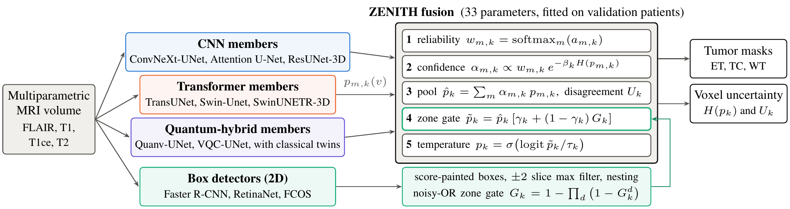
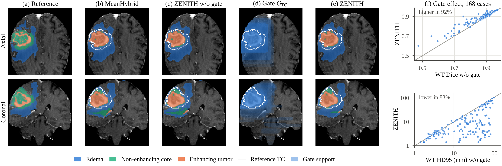
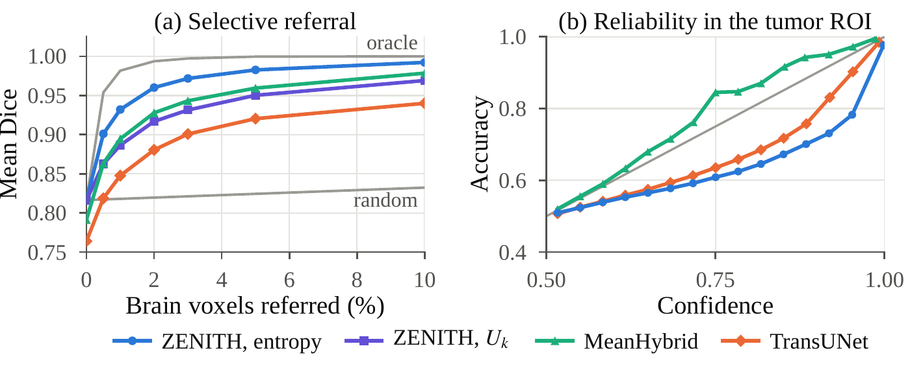
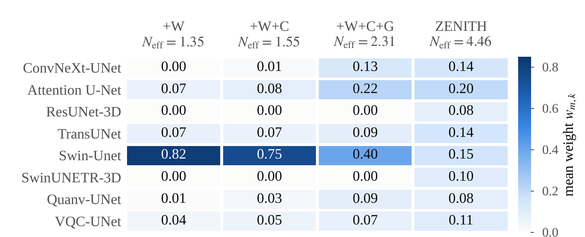
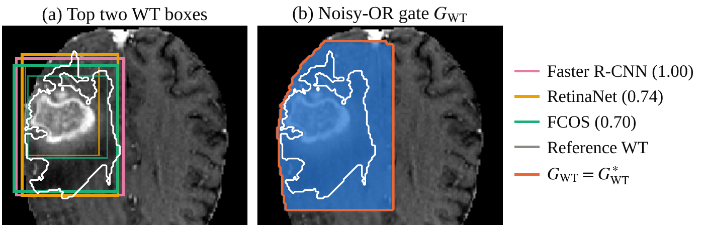

<div align="center">

# ZENITH

**Detection-gated hybrid fusion of CNN, transformer and quantum-hybrid networks for brain tumor segmentation on MRI**

[](https://www.python.org/)
[](https://pytorch.org/)
[](https://monai.io/)
[](https://www.kaggle.com/)
[](https://www.med.upenn.edu/cbica/brats2020/)
[](LICENSE)

[Overview](#overview) •
[Results](#results) •
[Method](#method) •
[Quick start](#quick-start) •
[Outputs](#outputs) •
[Citation](#citation)

<br>



</div>

<br>

> [!NOTE]
> This repository contains the code behind the paper **"ZENITH: Detection-Gated Opinion Pooling of CNN, Transformer and Quantum-Hybrid Segmenters for Brain Tumor MRI"**. Full citation details will be added once the paper is published.

## Overview

On MRI, a glioma is outlined as three nested regions: the whole tumor (WT), the tumor core (TC) inside it, and the enhancing tumor (ET) inside the core. A single network usually captures the bulk of the lesion but leaves small false islands far away from it, and those islands are what drive boundary metrics such as HD95 up.

ZENITH attacks this from two sides. First, it combines eight segmentation networks of very different design through a small fusion head that learns how much to trust each network and how strongly to discount voxels where a network is unsure. Second, it asks three box detectors where the tumor is and keeps the fused probability only inside those zones. A learned temperature then calibrates the result. The whole fusion head has **33 parameters** and works on top of networks that are already trained.

For every case, ZENITH returns a mask per region and two voxel-wise uncertainty maps: the entropy of the fused prediction and the share of it caused by disagreement between members.

**Highlights**

- **One notebook, end to end.** Data checks, thirteen models, fusion, statistics, fifteen figures and nine tables all come from a single run of `zenith.ipynb`.
- **Mixed members.** 2D and 3D CNNs, 2D and 3D transformers, and two U-Nets with exactly simulated quantum circuits.
- **Detection as a spatial prior.** Faster R-CNN, RetinaNet and FCOS boxes are painted into soft 3D zones, merged with a noisy-OR and used to gate the fused map.
- **Provable behavior.** The temperature can never change a mask, and a voxel can only become tumor where the gate support passes an explicit threshold.
- **A fair quantum test.** Each quantum model is paired with a classical twin that has exactly the same number of parameters.
- **Careful statistics.** Repeated splits over patients, corrected t-tests, Wilcoxon and Friedman tests, plus calibration and uncertainty-based referral.
- **Built for Kaggle.** Every finished model is saved at once, so an interrupted session continues where it stopped.

## Results

Three repeats of Monte Carlo cross-validation over patients (MCCV) on the 369 BraTS 2020 training cases, with 56 test patients per repeat (168 test cases in total). Values are means over the repeats; HD95 is in millimeters and lower is better.

| Model | Type | ET Dice | ET HD95 | TC Dice | TC HD95 | WT Dice | WT HD95 |
|:--|:--:|:--:|:--:|:--:|:--:|:--:|:--:|
| Attention U-Net | 2D CNN | 0.667 | 66.9 | 0.775 | 46.7 | 0.850 | 48.3 |
| TransUNet | 2D transformer | 0.668 | 65.3 | 0.770 | 44.9 | 0.853 | 47.7 |
| Swin-Unet | 2D transformer | 0.694 | 36.4 | 0.753 | 23.4 | 0.843 | 33.6 |
| VQC-UNet | 2D quantum-hybrid | 0.662 | 69.3 | 0.757 | 50.3 | 0.854 | 48.2 |
| MeanHybrid (uniform average) | 2D + 3D hybrid | 0.701 | 51.1 | 0.803 | 25.7 | 0.871 | 38.8 |
| **ZENITH** | **2D + 3D hybrid** | **0.738** | **31.2** | **0.814** | **8.7** | **0.897** | **17.0** |

<details>
<summary><b>All models with standard deviations, size, rank and runtime</b></summary>
<br>

| Model | ET Dice | ET HD95 | TC Dice | TC HD95 | WT Dice | WT HD95 | Rank | Params (M) | Time (s) |
|:--|:--:|:--:|:--:|:--:|:--:|:--:|:--:|:--:|:--:|
| ConvNeXt-UNet | 0.672 ± 0.036 | 66.4 ± 7.3 | 0.744 ± 0.018 | 51.6 ± 8.7 | 0.834 ± 0.012 | 54.5 ± 2.9 | 5.95 | 9.4 | 0.99 |
| Attention U-Net | 0.667 ± 0.022 | 66.9 ± 14.7 | 0.775 ± 0.015 | 46.7 ± 13.9 | 0.850 ± 0.015 | 48.3 ± 7.0 | 4.59 | 7.9 | 0.65 |
| ResUNet-3D | 0.538 ± 0.040 | 87.6 ± 4.8 | 0.495 ± 0.060 | 66.7 ± 9.5 | 0.578 ± 0.065 | 67.3 ± 1.4 | 9.42 | 16.8 | 0.84 |
| TransUNet | 0.668 ± 0.051 | 65.3 ± 9.1 | 0.770 ± 0.031 | 44.9 ± 3.8 | 0.853 ± 0.016 | 47.7 ± 4.3 | 4.86 | 18.7 | 0.66 |
| Swin-Unet | 0.694 ± 0.041 | 36.4 ± 17.3 | 0.753 ± 0.017 | 23.4 ± 0.7 | 0.843 ± 0.008 | 33.6 ± 3.8 | 5.30 | 27.2 | 0.64 |
| SwinUNETR-3D | 0.521 ± 0.083 | 87.3 ± 11.9 | 0.513 ± 0.055 | 70.1 ± 9.3 | 0.608 ± 0.094 | 68.9 ± 1.6 | 9.39 | 15.7 | 1.73 |
| Quanv-UNet | 0.648 ± 0.037 | 76.6 ± 11.6 | 0.751 ± 0.033 | 53.4 ± 10.1 | 0.831 ± 0.005 | 53.8 ± 1.9 | 6.24 | 7.8 | 0.62 |
| Quanv-UNet (classical twin) | 0.666 ± 0.037 | 69.0 ± 5.7 | 0.781 ± 0.027 | 45.5 ± 12.7 | 0.854 ± 0.004 | 51.3 ± 2.8 | n/a | 7.8 | 0.57 |
| VQC-UNet | 0.662 ± 0.044 | 69.3 ± 10.0 | 0.757 ± 0.005 | 50.3 ± 8.3 | 0.854 ± 0.011 | 48.2 ± 6.7 | 5.40 | 7.8 | 0.58 |
| VQC-UNet (classical twin) | 0.666 ± 0.045 | 67.0 ± 8.6 | 0.765 ± 0.010 | 45.9 ± 7.7 | 0.859 ± 0.002 | 46.0 ± 4.5 | n/a | 7.8 | 0.57 |
| MeanHybrid | 0.701 ± 0.040 | 51.1 ± 9.5 | 0.803 ± 0.034 | 25.7 ± 3.4 | 0.871 ± 0.005 | 38.8 ± 6.6 | 2.34 | 111.2 | 7.25 |
| **ZENITH** | **0.738 ± 0.036** | **31.2 ± 13.7** | **0.814 ± 0.026** | **8.7 ± 1.2** | **0.897 ± 0.002** | **17.0 ± 3.9** | 1.51 | 194.5 | 10.68 |

Rank averages each model's Friedman rank over patients, based on patient Dice; the two twins serve as controls and are left out of the ranking. Time is the median number of seconds per volume on a Tesla T4.

</details>

### What the experiments show

- Compared with the best individual network for each region (classical twins included), ZENITH adds 0.045 (ET), 0.033 (TC) and 0.038 (WT) Dice, and roughly halves the best single WT HD95 (33.6 mm to 17.0 mm).
- Against plain averaging of the same eight members, the improvement comes mainly from precision (0.831 against 0.777, averaged over regions), while sensitivity stays close (0.850 against 0.867).
- The detection gate is the most important part. Without it, ET Dice drops by 0.035 and WT HD95 climbs back to 33.8 mm.
- Fitting the member weights on their own makes them collapse onto Swin-Unet, leaving an effective 1.35 of 8 members. Fitted jointly with the gate and the temperature, 4.46 effective members remain.
- Both quantum-hybrid U-Nets fall short of their parameter-matched classical twins for all three regions, and leaving them out of the fusion moves Dice by 0.005 at most.
- If a reader corrects the 1% of brain voxels where ZENITH is least sure, mean Dice goes from 0.816 to 0.932.
- ZENITH ranks first in all three repeats (Friedman test). The cost is runtime: all eleven networks take about 10.7 s per volume on a T4, against 0.7 s for TransUNet alone.

<details>
<summary><b>Fusion ablation</b></summary>
<br>

| Variant | N<sub>eff</sub> | Members | ET Dice | ET HD95 | TC Dice | TC HD95 | WT Dice | WT HD95 |
|:--|:--:|:--:|:--:|:--:|:--:|:--:|:--:|:--:|
| MeanHybrid (uniform) | 8.00 | 8 | 0.701 | 51.1 | 0.803 | 25.7 | 0.871 | 38.8 |
| +W | 1.35 | 8 | 0.694 | 36.4 | 0.767 | 21.6 | 0.851 | 35.8 |
| +W+C | 1.55 | 8 | 0.699 | 36.2 | 0.779 | 20.4 | 0.868 | 32.0 |
| +W+C+G | 2.31 | 8 | 0.724 | 30.1 | 0.800 | 11.5 | 0.888 | 20.3 |
| **ZENITH (+W+C+G+T)** | 4.46 | 8 | **0.738** | 31.2 | **0.814** | **8.7** | **0.897** | **17.0** |
| without CNN members | 3.42 | 5 | 0.734 | 31.2 | 0.806 | 9.4 | 0.894 | 17.3 |
| without transformer members | 3.21 | 5 | 0.734 | 34.1 | 0.817 | 10.1 | 0.893 | 21.0 |
| without quantum-hybrid members | 3.63 | 6 | 0.743 | 29.0 | 0.813 | 8.8 | 0.896 | 17.3 |
| without detection gate | 3.95 | 8 | 0.703 | 45.9 | 0.801 | 20.4 | 0.877 | 33.8 |
| 2D members only | 3.17 | 6 | 0.735 | 31.3 | 0.810 | 11.5 | 0.892 | 19.0 |
| 3D members only | 1.75 | 2 | 0.683 | 31.1 | 0.648 | 15.4 | 0.831 | 26.3 |

W: learned reliability weights, C: confidence modulation, G: detection gate, T: temperature. N<sub>eff</sub> = 1 / Σ<sub>m</sub> w<sub>m</sub><sup>2</sup> is the effective number of members.

</details>

<p align="center">
  
</p>
<p align="center"><sub>One test case in two planes: reference, uniform average, ZENITH without and with the gate, and the gate's effect on each of the 168 test cases.</sub></p>

<table>
  <tr>
    <td width="50%"></td>
    <td width="50%"></td>
  </tr>
  <tr>
    <td align="center"><sub>Left: Dice when the least certain voxels are corrected by a reader. Right: confidence against accuracy around the tumor.</sub></td>
    <td align="center"><sub>How the learned weights shift as each fusion step is added</sub></td>
  </tr>
</table>

## Method

### Members

| Input | CNN | Transformer | Quantum-hybrid |
|:--|:--|:--|:--|
| 2D axial slices | ConvNeXt-UNet, Attention U-Net | TransUNet, Swin-Unet | Quanv-UNet, VQC-UNet |
| 3D volumes | ResUNet-3D | SwinUNETR-3D | |

The detection side uses Faster R-CNN, RetinaNet and FCOS on 2D slices, and their boxes are stacked slice by slice into 3D zones. Each quantum-hybrid model also has a classical twin, which is trained and scored as a control but never fused.

All networks are trained from scratch in every repeat with one recipe: AdamW, a short linear warm-up followed by cosine decay, mixed precision and gradient clipping. Segmenters minimize binary cross-entropy plus soft Dice on the three regions; detectors use their own losses and start from ImageNet backbones.

| | 2D segmenters | 3D segmenters | Detectors |
|:--|:--:|:--:|:--:|
| Input | 192 × 192 slices | 96 × 96 × 96 patches | 192 × 192 slices |
| Batch | 16 | 2 | 16 |
| Iterations (`standard` / `quick`) | 1,500 / 700 | 1,000 / 500 | 1,200 / 600 |
| Learning rate | 3 × 10<sup>-4</sup> | 3 × 10<sup>-4</sup> | 1 × 10<sup>-4</sup> |

### Quantum-hybrid members

Inputs enter each circuit as $R_Y$ rotation angles. Every one of the $L$ trainable layers turns each qubit with $R_Z$ and $R_Y$ and then entangles neighbors through a closed chain of CNOTs, and the outputs are the Z expectation values of the qubits. **Quanv-UNet** runs a 4-qubit, 2-layer circuit on every 2 × 2 patch, separately for each MRI sequence, and passes the resulting 16 channels to a U-Net. **VQC-UNet** maps every bottleneck token to an 8-qubit, 4-layer circuit and adds the output back through a residual projection. The state vector is simulated exactly on the GPU, so no quantum hardware is involved. A second, deliberately naive simulator that applies one gate at a time, together with parameter-shift gradients, agrees with it to better than 10<sup>-6</sup>. The classical twins swap the circuit for a tanh layer with exactly the same parameter count, which isolates the effect of the circuit itself.

### Fusion

Let $p_{m,k}(v)$ be the probability that member $m$ gives region $k$ at voxel $v$, and $H(p)$ the binary entropy. ZENITH applies five steps:

```math
\begin{aligned}
w_{m,k} &= \operatorname{softmax}_m(a_{m,k}) && \text{reliability}\\
\alpha_{m,k} &= \frac{w_{m,k}\, e^{-\beta_k H(p_{m,k})}}{\sum_{j} w_{j,k}\, e^{-\beta_k H(p_{j,k})}} && \text{confidence}\\
\hat p_k &= \sum_m \alpha_{m,k}\, p_{m,k} && \text{opinion pool}\\
\tilde p_k &= \hat p_k \bigl[\gamma_k + (1-\gamma_k)\, G_k\bigr] && \text{detection gate}\\
p_k &= \sigma\bigl(\operatorname{logit}(\tilde p_k)/\tau_k\bigr) && \text{temperature}
\end{aligned}
```

where $\beta_k = \operatorname{softplus}(b_k)$, $\gamma_k = \sigma(g_k)$ and $\tau_k = e^{t_k}$. Together, the weights $a_{m,k}$ (8 × 3) and the scalars $b_k, g_k, t_k$ (3 × 3) make up 33 parameters. They are learned in each repeat from 12 validation patients (60,000 sampled brain voxels per patient), using Adam on the same BCE plus soft Dice objective.

The fused entropy splits into what the members are unsure about and what they disagree on:

```math
H(\hat p_k) = \sum_m \alpha_{m,k} H(p_{m,k}) + U_k .
```

The second term, $U_k \ge 0$, measures how far the members spread apart; it equals their weighted Jensen-Shannon divergence.

### Detection gate

On every axial slice the detectors propose boxes for each region with a confidence score. Each box is grown by 8 pixels and filled with its score, which turns detector $d$ into a support map $G_k^d$. Taking the maximum across two neighboring slices on each side closes gaps where a detector skipped a slice, and the maps are made nested, so ET support never exceeds TC support and TC never exceeds WT. The three maps are then combined as independent votes:

```math
G_k = 1 - \prod_d \bigl(1 - G_k^d\bigr).
```

A single sure detector can open a zone on its own, several agreeing detectors push the support higher, and a silent detector leaves it unchanged instead of pulling it down as an average would.

### Two guarantees

- **The temperature never edits a mask.** For any $\tau_k > 0$, the calibrated probability crosses 0.5 exactly where the gated one does.
- **The gate acts as a veto.** If $\gamma_k < 1/2$, a voxel can only be labeled tumor where $G_k \ge (1/2 - \gamma_k)/(1 - \gamma_k)$. The fitted leakage stays below 0.06, which puts this threshold between 0.47 and 0.49.

### Evaluation protocol

- **Splits.** Three MCCV repeats over patients (seeds 42 to 44), each dividing the cases 70/15/15% (258 / 55 / 56 patients for training, validation and testing). Every model is retrained in every repeat.
- **Scoring.** On the original 240 × 240 × 155 grid at 1 mm. If either the prediction or the reference is empty but not both, HD95 takes the BraTS penalty of 373.13 mm, the length of the image diagonal.
- **Metrics.** Dice, HD95, sensitivity and precision; expected calibration error (15 bins) over the brain and inside a 10 mm tumor ROI; Brier score; AURC, uncertainty-error overlap and selective referral curves; AP<sub>50</sub> for the detectors, and recall and coverage for the gate.
- **Statistics.** Nadeau-Bengio corrected resampled t-test with Holm adjustment, per-repeat Wilcoxon signed-rank tests with rank-biserial effect sizes, and the Friedman test followed by Nemenyi's critical-difference analysis.

<p align="center">
  
</p>
<p align="center"><sub>Left: the strongest WT boxes from each detector. Right: the merged zone map, with the contour where the veto threshold is reached.</sub></p>

## Quick start

### Run on Kaggle

1. Import `zenith.ipynb` into a new Kaggle notebook.
2. Add both datasets as inputs:
   - [BraTS 2020 NIfTI volumes](https://www.kaggle.com/datasets/talhaumar/brats2020-correct-dataset-training-validation), which contains `MICCAI_BraTS2020_TrainingData`
   - [BraTS 2020 HDF5 slices](https://www.kaggle.com/datasets/awsaf49/brats2020-training-data), which contains `BraTS2020_training_data/content/data`
3. In the notebook settings, choose the **GPU T4** accelerator and turn **Internet** on. MONAI is installed at start-up and the detector backbones download ImageNet weights.
4. Choose a profile in Section 1 and press **Run all**.

| Profile | Training budget | Typical use |
|:--|:--|:--|
| `standard` | full iteration budgets | the reported results; about 6 h for three repeats on one T4 in our run |
| `quick` | about half the iterations, 8 fitting patients | a faster full pass |

> [!TIP]
> A Kaggle session ends after 12 hours. The notebook stops cleanly before that limit and keeps everything it has finished. To continue, add the earlier run's output as an input, list its path in `PREV_OUTPUT_DIRS` in Section 1 and run again; finished models and repeats are skipped.

### Run locally

```bash
pip install torch torchvision "monai>=1.3" nibabel h5py numpy scipy pandas matplotlib seaborn jupyter

export BRATS_NII_ROOT=/path/to/MICCAI_BraTS2020_TrainingData
export BRATS_H5_ROOT=/path/to/BraTS2020_training_data/content/data
export BRATS_WORK_DIR=./outputs

jupyter nbconvert --to notebook --execute zenith.ipynb --output zenith_executed.ipynb --ExecutePreprocessor.timeout=-1
```

A CUDA GPU with 16 GB of memory is enough for the `standard` profile. Setting `BRATS_SMOKE=1` runs every code path on a CPU with tiny models in a few minutes, which is useful for checking an installation (the numbers it produces are meaningless).

### Configuration

All paths and budgets can be overridden with environment variables, so the same notebook runs on Kaggle and on a workstation.

| Variable | Default | Purpose |
|:--|:--|:--|
| `BRATS_PROFILE` | `standard` | `standard` or `quick` |
| `BRATS_SMOKE` | `0` | `1` for the CPU smoke test |
| `BRATS_NII_ROOT` | Kaggle path | folder with the `BraTS20_Training_*` NIfTI cases |
| `BRATS_H5_ROOT` | Kaggle path | folder with the `volume_*_slice_*.h5` files |
| `BRATS_WORK_DIR` | `/kaggle/working` | where all outputs are written |
| `BRATS_CACHE_DIR` | `/tmp/brats_cache` | cache of cropped float16 volumes |
| `BRATS_MCCV_REPEATS` | `3` | number of MCCV repeats |
| `BRATS_RUN_REPEATS` | all | JSON list of repeats for this session, for example `[0]` |
| `BRATS_ITERS_2D`, `BRATS_ITERS_3D`, `BRATS_ITERS_DET` | `1500`, `1000`, `1200` | training iterations |
| `BRATS_NUM_WORKERS` | `4` | data loader workers |
| `BRATS_MODELS` | all | JSON list that restricts the model zoo, for debugging |

<details>
<summary><b>Main settings in Section 1</b></summary>
<br>

| Setting | Value | Meaning |
|:--|:--|:--|
| `CROP_2D` | 192 | in-plane crop for 2D models and detectors |
| `PATCH_3D`, `SW_OVERLAP` | 96³, 0.5 | 3D patch size and sliding-window overlap |
| `FG_PROB_3D`, `BG_SLICE_FRAC` | 0.67, 0.10 | share of tumor-centered 3D patches, share of tumor-free slices |
| `Q_QUBITS_QUANV`, `Q_LAYERS_QUANV` | 4, 2 | Quanv circuit size |
| `Q_QUBITS_VQC`, `Q_LAYERS_VQC` | 8, 4 | VQC circuit size |
| `DET_DILATE_PX`, `DET_Z_DILATE`, `DET_SCORE_MIN` | 8, 2, 0.05 | box enlargement, slice filter, minimum box score |
| `ZENITH_FIT_PATIENTS`, `ZENITH_VOXELS_PER_PATIENT` | 12, 60,000 | data used to fit the fusion head |
| `ZENITH_STEPS`, `ZENITH_LR` | 300, 0.05 | Adam steps and learning rate for the fusion head |
| `ECE_BINS`, `ROI_MARGIN_MM` | 15, 10 | calibration bins and tumor ROI margin |
| `SESSION_HOURS` | 11.5 | clean stop before the Kaggle limit |

</details>

## Outputs

Everything is written to `BRATS_WORK_DIR` (by default `/kaggle/working`).

| Folder | Contents |
|:--|:--|
| `checkpoints/r<k>/` | final weights of every model in repeat k |
| `results/r<k>/` | per-patient test metrics, fitted fusion parameters, calibration histograms, referral curves, detector scores, gate statistics, timing, training histories and arrays for the figures |
| `tables/` | nine result tables as CSV and LaTeX, per-repeat summaries, `key_numbers.json` and `run_config.json` with the exact settings and package versions |
| `figures/` | fifteen figures as 300 dpi PNG and vector PDF |
| `index/` | patient indices, the verified HDF5 to NIfTI alignment and the MCCV splits |
| `zenith_outputs.zip` | everything above except the checkpoints, ready to download |

<details>
<summary><b>Tables and figures produced by a run</b></summary>
<br>

| Table | Content |
|:--|:--|
| `table1_data_mccv` | patients and 2D slices per repeat |
| `table2_main_results` | Dice and HD95 per region, ECE and Brier for every model and both fusions |
| `table3_ablation` | fusion chain and leave-one-family-out |
| `table4_detection` | AP<sub>50</sub> per region, mAP<sub>50</sub>, gate recall and coverage |
| `table5_quantum_vs_twin` | quantum-hybrid models against their classical twins |
| `table6_efficiency` | parameters, GFLOPs and seconds per volume |
| `table7_pairwise_zenith` | ZENITH against every model and variant (corrected t-test and Wilcoxon) |
| `table8_friedman` | Friedman test and mean ranks per repeat |
| `table9_zenith_parameters` | learned weights, confidence, leakage and temperature per repeat |

| Figures | Content |
|:--|:--|
| `fig01` to `fig03` | architecture, preprocessing, sampling and MCCV design |
| `fig04` | training curves across repeats |
| `fig05`, `fig06` | detection zones and the quantum circuits with their feature maps |
| `fig07` to `fig10` | segmentation, gating, uncertainty and reliability before and after fusion |
| `fig11` to `fig15` | MCCV results, ablation, learned parameters, accuracy against cost and selective referral |

</details>

## Repository structure

| Path | Description |
|:--|:--|
| `zenith.ipynb` | the complete pipeline, organized in Sections 0 to 17 |
| `assets/` | figures shown in this README |
| `LICENSE` | license text |

<details>
<summary><b>Notebook map</b></summary>
<br>

| Section | What it does |
|:--:|:--|
| 0 | environment setup and GPU check |
| 1 | configuration and run profiles |
| 2 | dataset discovery and per-patient file resolution |
| 3 | patient-level MCCV splits |
| 4 | indexing and the HDF5 to NIfTI alignment check |
| 5 | datasets, sampling and augmentation for 2D, 3D and detection |
| 6 | model zoo with mathematical notes, quantum simulator and self-checks |
| 7 | inference on the NIfTI grid and detection zone gates |
| 8 | metrics |
| 9 | training recipe |
| 10 | ZENITH fusion and its ablations |
| 11 | per-repeat evaluation |
| 12 | MCCV statistics and tables |
| 13 | figure functions |
| 14 | main loop: train, fit and evaluate every repeat |
| 15, 16 | tables and figures |
| 17 | key numbers and the download archive |

</details>

## Reproducibility

- Splits come from fixed seeds and are saved in `index/mccv_splits.json`; every model in a repeat sees the same patients.
- The HDF5 slice export ships without documentation of its orientation, mask encoding or channel order. The notebook works all three out from the images and keeps a patient only if the stacked slice masks agree with the NIfTI labels at a Dice of 0.99 or higher; all 369 patients meet this bar.
- Case `BraTS20_Training_355`, whose label file has a nonstandard name in some mirrors, is resolved automatically.
- The final weights of each model are evaluated. Validation patients are used only for learning curves and for fitting the 33 fusion parameters, never for model selection.
- Every number in the generated tables is computed from the saved result files, and `key_numbers.json` collects the headline values.
- `run_config.json` records the profile, all settings, the GPU and the package versions of each run. The reported run used Python 3.13, PyTorch 2.11, torchvision 0.26, MONAI 1.6.1 and NumPy 2.1 on a 16 GB Tesla T4.

## Citation

If this code helps your work, please cite the paper:

```bibtex
@misc{zenith2026,
  title  = {{ZENITH}: Detection-Gated Opinion Pooling of {CNN}, Transformer and Quantum-Hybrid Segmenters for Brain Tumor {MRI}},
  author = {First Author and Second Author and Third Author and Fourth Author and Fifth Author},
  year   = {2026}
}
```

## Acknowledgments

The experiments use the BraTS 2020 training data. If you use these data, please cite the challenge papers:

1. B. H. Menze et al., "The multimodal brain tumor image segmentation benchmark (BRATS)," *IEEE Transactions on Medical Imaging*, vol. 34, no. 10, pp. 1993-2024, 2015.
2. S. Bakas et al., "Advancing The Cancer Genome Atlas glioma MRI collections with expert segmentation labels and radiomic features," *Scientific Data*, vol. 4, art. 170117, 2017.
3. S. Bakas et al., "Identifying the best machine learning algorithms for brain tumor segmentation, progression assessment, and overall survival prediction in the BRATS challenge," arXiv:1811.02629, 2018.

We thank the maintainers of the two Kaggle mirrors listed above. The code builds on [PyTorch](https://pytorch.org/), [torchvision](https://pytorch.org/vision/) and [MONAI](https://monai.io/).

## License

The code is released under the MIT License; see [LICENSE](LICENSE). The BraTS data are not included in this repository and remain subject to the terms set by the challenge organizers.

<div align="center">
<br>
<sub>Questions and bug reports are welcome through GitHub issues.</sub>
</div>
